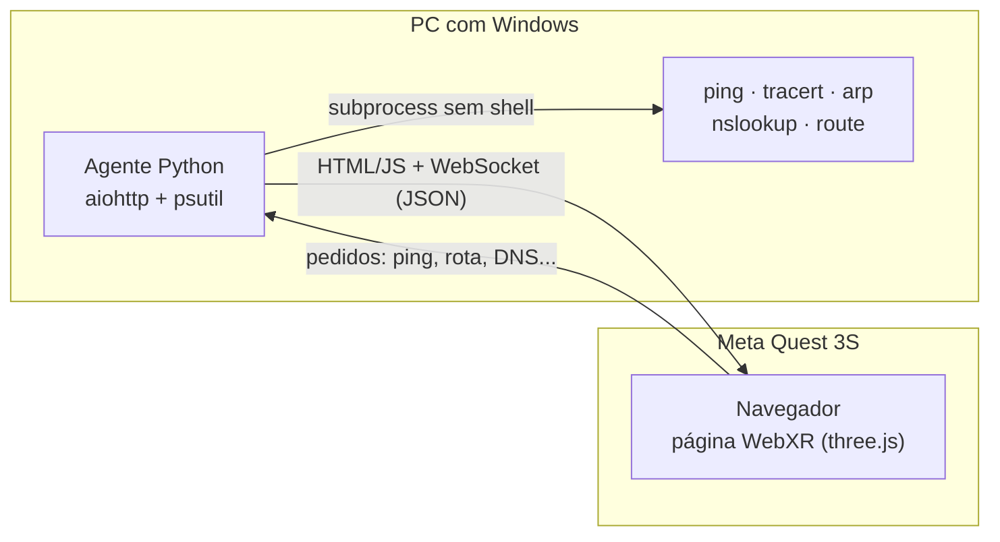

# NetHolo · laboratório de redes em realidade mista

> A rede da sua casa em holograma, em volta da sua mesa. Você usa o PC normalmente, de
> **Meta Quest 3S**, e vê aparelhos, conexões e pacotes "vivos" no ar. Cada clique roda o
> **comando real** no PC (`ping`, `tracert`, `arp`, `nslookup`...) e mostra a saída num
> **terminal espelho** ao lado.

[](https://github.com/Reinaldo-Porfirio/netholo/actions/workflows/ci.yml)


Quase todo o trabalho com redes acontece lendo texto num terminal. O NetHolo é um laboratório
para **ver** o que esses comandos fazem: a varredura ARP vira uma onda saindo do PC, um ping
vira uma bolinha que vai e volta, e um traceroute acende salto por salto até a Internet.

<!-- Coloque aqui um GIF gravado no Quest (botão Meta → Câmera → Gravar vídeo). -->

## A trilha (do básico ao avançado)

| Nível | Conceito | Comando real | No holograma |
|---|---|---|---|
| 1 | IP, máscara, gateway, DNS, MAC | `route print` + psutil (≈ `ipconfig /all`) | etiquetas clicáveis ao lado do PC |
| 2 | Rede local e ARP | `arp -a` + ping sweep da sub-rede | onda saindo do PC, aparelhos surgindo um a um |
| 3 | Ping e latência (ICMP) | `ping` | bolinha vai e volta; verde, âmbar ou vermelho |
| 4 | Caminho até a Internet | `tracert` | saltos acendendo até a esfera da Internet (CGNAT em violeta) |
| 5 | DNS e cache | `nslookup` | consulta indo ao servidor DNS; na repetição, o cache do PC responde |
| 6 | Portas, protocolos e programas | psutil (≈ `netstat -ano`) | linhas de cada programa até seus destinos, com tráfego ao vivo |

**Interação:** o gatilho do controle (ou a pinça com a mão) seleciona; o **grip** segura e move
a cena inteira. Cada nó abre um painel com detalhes e botões (Ping, Rota...).

## Arquitetura



- **Sem app instalado no óculos:** o próprio agente serve a página e o WebSocket no mesmo processo.
- **WebSocket** porque o agente precisa *empurrar* dados em tempo real (cada resposta de ping,
  cada salto, a vazão a cada segundo) sem o óculos ficar perguntando.
- **O óculos nunca executa comandos:** ele pede uma ação de uma lista fechada; o agente valida
  e executa. É o mesmo padrão cliente/servidor de qualquer sistema web.
- **Por que `localhost` ou HTTPS:** o WebXR só funciona em *contexto seguro*. Pelo cabo USB, o
  `adb reverse` faz o Quest enxergar o PC como `localhost`, que já conta como seguro.

## Como rodar

Pré-requisitos: Windows 10/11, Python 3.11+ e Git.

```powershell
git clone https://github.com/Reinaldo-Porfirio/netholo.git
cd netholo
python -m venv .venv
.venv\Scripts\pip install -e ".[dev]"
.venv\Scripts\python -m netholo --update-oui   # opcional: base de fabricantes (fica no cache do usuário)
```

### 1. Testar no PC (sem óculos)

```powershell
.venv\Scripts\python -m netholo --demo
```

Abra a URL que aparece no terminal (`http://localhost:8765/?t=...`). Arraste para girar, use a
rodinha para aproximar e clique nos hologramas e botões. O `--demo` usa **dados falsos**; sem
ele, o agente usa a sua rede de verdade.

### 2. No Quest 3S pelo cabo USB (recomendado)

1. Ative o **modo desenvolvedor** do Quest (app Meta Horizon no celular → Dispositivos →
   Configurações do headset → Modo desenvolvedor).
2. Instale o adb no PC: `winget install Google.PlatformTools`.
3. Ligue o Quest no PC pelo cabo USB-C e aceite **"Permitir depuração USB"** dentro do óculos.
4. Rode:

   ```powershell
   .venv\Scripts\python -m netholo --adb
   ```

   O agente faz o `adb reverse` e abre a página no navegador do Quest sozinho. Toque em
   **Entrar em realidade mista**: a cena aparece à sua frente, sobre o quarto real.

> Sem o `--adb`: rode `adb reverse tcp:8765 tcp:8765` e digite no navegador do Quest a URL
> com o token que aparece no terminal.

### 3. Pelo Wi-Fi (avançado)

Pelo Wi-Fi a página precisa de HTTPS de verdade. Gere um certificado (por exemplo com o
[mkcert](https://github.com/FiloSottile/mkcert)), instale a CA no Quest e rode:

```powershell
.venv\Scripts\python -m netholo --lan --cert certs\pc.pem --key certs\pc-key.pem
```

Sem certificado o servidor **se recusa** a abrir para a rede: o token trafegaria sem criptografia.

## Segurança

O agente executa comandos no PC a pedido de um navegador, então a segurança é parte do projeto:

| Risco | Proteção |
|---|---|
| Injeção de comando (`8.8.8.8; calc`) | `create_subprocess_exec` com lista de argumentos, **nunca shell** |
| Injeção de argumento (`-t 8.8.8.8` = ping infinito) | alvo validado: IP ou hostname RFC 1123, nunca começa com `-` |
| Outro site abrindo o WebSocket (CSWSH) | verificação do cabeçalho `Origin` |
| Outro aparelho da rede usando o agente | token aleatório por execução (`secrets`), comparado em tempo constante; por padrão o servidor só escuta em `127.0.0.1` |
| Token vazando | `Referrer-Policy: no-referrer`, log de acesso desligado, token removido da barra de endereço |
| Abuso / travamento | lista fechada de ações, limite de tamanho de mensagem, de mensagens por segundo e de tarefas simultâneas, tempo limite em todo comando |
| XSS | nenhum `innerHTML`: textos são desenhados em canvas; CSP restritiva |
| Privacidade | nada é gravado em disco; prints e GIFs usam o modo `--demo` (IPs de documentação, RFC 5737) |

Use a varredura apenas na **sua** rede.

## Estrutura

```
netholo/            agente (Python)
  server.py         HTTP + WebSocket, protocolo, limites
  agent.py          o que cada nível executa (agente real)
  demo.py           agente de demonstração (dados falsos)
  parsers.py        leitura da saída dos comandos (independe do idioma do Windows)
  security.py       validação de alvos, token, Origin
  runner.py         execução segura de comandos (sem shell, com tempo limite)
  connections.py    conexões por programa + DNS reverso com cache
web/                visualizador (WebXR + three.js, sem bundler)
  js/world.js       a cena da rede e as animações de cada nível
  js/interaction.js raio do controle, mouse e grip
  js/panel.js       painéis 3D com botões (canvas → textura)
tests/              pytest: parsers, segurança e servidor
```

## Testes

```powershell
.venv\Scripts\pytest          # 64 testes: parsers com saídas reais, validações, servidor
.venv\Scripts\ruff check .    # lint (inclui regras de segurança do Bandit)
```

O GitHub Actions roda lint e testes no **Windows e no Linux** (Python 3.11 e 3.12) a cada push.

## Próximos passos

- [ ] Nível 7: handshake TCP e TLS em câmera lenta (captura com Npcap + scapy)
- [ ] Nível 8: portas abertas dos aparelhos (`nmap`, só na própria rede)
- [ ] Nível 9: Pi-hole numa VM Ubuntu mostrando os domínios consultados por aparelho
- [ ] Nível 10: containers e Kubernetes (k3s) em holograma

## Licença

[MIT](LICENSE)
